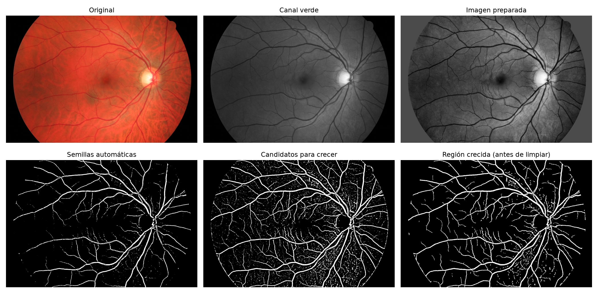

# Segmentación de vasos sanguíneos en retina

Segmentación de vasos sanguíneos en imágenes de retina con dos métodos tradicionales:

1. **Umbralización adaptativa:** compara cada píxel con su entorno.
2. **Crecimiento de regiones:** conserva candidatos conectados a semillas automáticas por ocho vecinos.

Proyecto de visión por computador con OpenCV sobre la base HRF. El código, los comentarios y el notebook están en español. Se utilizan técnicas tradicionales, sin aprendizaje automático.

## Notebook

Abrir [Examen_parcial_V2.ipynb](Examen_parcial_V2.ipynb). Incluye el código, imágenes intermedias y resultados guardados. Para volver a ejecutarlo se necesitan los datos HRF y las dependencias indicadas abajo.



## Resultados

Se usaron seis imágenes para elegir parámetros y otras 39 para la comparación. Cada imagen tiene el mismo peso. Dice e IoU se calculan dentro de todo el campo visual y a resolución original.

| Método | Dice medio | IoU medio |
| --- | ---: | ---: |
| Umbral adaptativo | 0,7116 | 0,5554 |
| Crecimiento de regiones | 0,7152 | 0,5607 |

Las diferencias son pequeñas. Ambos métodos omiten vasos finos y producen falsas detecciones. Los 39 casos ya se habían observado en V1; la comparación es exploratoria sobre la misma partición. V2 no superó el mejor promedio de V1.

Consultar el [informe](resultados/evaluacion/INFORME.md), las [métricas por imagen](resultados/evaluacion/metricas.csv) y el [resumen](resultados/evaluacion/resumen.csv).

## Organización

```text
codigo/                 Lectura, métodos, ajuste, ejecución y comprobaciones.
configuracion/          Opciones probadas y parámetros elegidos.
resultados/             Tablas, figuras y pasos intermedios.
predicted_masks/        90 máscaras: 45 por método.
referencias/            Resumen de V1 para la comparación.
documentacion/          Guía para exponer el notebook.
Examen_parcial_V2.ipynb  Notebook con las salidas ejecutadas.
```

## Preparar Python

Se utilizó Python 3.14. Desde la carpeta del repositorio:

```bash
python3.14 -m venv .venv
.venv/bin/python -m pip install -r requirements-notebooks.txt
```

Para trabajar con el notebook, seleccionar el intérprete de `.venv` en el editor. Para usar solo los scripts basta instalar `requirements.txt`.

## Preparar los datos

Los datos originales no están incluidos. Se utilizó la base [High-Resolution Fundus (HRF)](https://www5.informatik.uni-erlangen.de/research/data/fundus-images/).

Colocar las 45 imágenes, sus referencias y sus campos visuales con esta estructura:

```text
datos/HRF/
├── images/     Fotografías .jpg o .JPG.
├── manual1/    Referencias de vasos .tif.
└── mask/       Campos visuales *_mask.tif.
```

Las imágenes, referencias y campos visuales se emparejan por identificador. Los casos `01` y `02` de cada grupo son desarrollo; los otros 39 se usan para comparar.

## Reproducir los resultados

Con los datos ya disponibles, aplicar los parámetros guardados:

```bash
.venv/bin/python codigo/ejecutar.py
.venv/bin/python codigo/resumir.py
.venv/bin/python codigo/verificar.py
```

Para repetir también la selección de parámetros con los seis casos de desarrollo:

```bash
.venv/bin/python codigo/ajustar.py
```

El ajuste compara una búsqueda pequeña. No selecciona parámetros con los resultados de los 39 casos.

`verificar.py` comprueba las 90 máscaras, sus tamaños, valores binarios, campo visual y métricas. También prueba el crecimiento con ejemplos pequeños conocidos.

## Exposición

La [guía del notebook](documentacion/GUIA_EXPOSICION.md) está organizada para una exposición de 10 a 12 minutos. El repositorio contiene los archivos técnicos; el video se entrega aparte.

## Contexto académico

Desarrollado como proyecto del examen parcial de Visión por Computador, Grupo 01, MIA. Se conserva la versión 2 como solución documentada.
